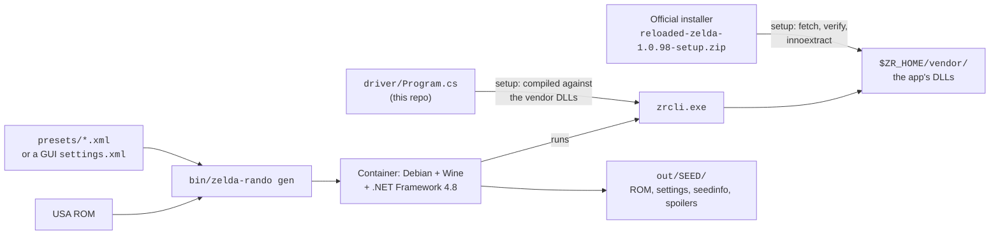

# zelda-remuxed

[Legend of Zelda Reloaded Randomizer](https://www.reloadedretro.com/games/zelda) 1.0.98
by MetalMachine is a randomizer for the NES Zelda that can generate a whole new
overworld and new dungeons. It is a Windows program with a graphical interface.
zelda-remuxed runs it headless on Linux, so you can make seeds from a script,
a server, or a cron job.

The tool does not re-implement the randomizer. A small C# driver loads the app's own
libraries and calls the same routine as the Generate button. It runs inside a Docker
container with Wine and Microsoft .NET Framework 4.8. For the same seed and settings,
the ROM is byte-identical to the one the Windows app makes. This was checked against
a seed made in the Windows app.

New here? Start with [docs/getting-started.md](docs/getting-started.md) (about 20 minutes).
Something broken? See [docs/troubleshooting.md](docs/troubleshooting.md).

**Requirements:** Linux with Docker, `innoextract`, `unzip`, `curl`, about 6 GB of
disk, and your own unmodified *Legend of Zelda, The (USA)* ROM. Tested on Fedora 44
with Docker 29.

> [!IMPORTANT]
> This repo contains **none** of the randomizer itself. Its license allows
> redistribution "in its original installable form only," so `zelda-rando setup`
> downloads the official installer from the author's update server and checks
> its SHA-256. Nothing extracted from it is committed (see `.gitignore`).

## How it fits together



| Piece | What it is |
|---|---|
| `bin/zelda-rando` | The wrapper you run. Fetches and builds everything, maps host paths into the container. |
| `driver/` | `zrcli`, a small C# console program. It loads the app's own DLLs and repeats what the GUI's Generate button does (`GenerateDlg.DoGeneration`). |
| `docker/Dockerfile` | Wine with Microsoft .NET Framework 4.8 installed by winetricks. |
| `presets/` | Five settings files, the script that builds them, and the hero sprite and NPC set each one uses. |
| `mods/redux/`, `tools/automap.py` | **Experimental: Zelda Remuxed.** Assembles features of [Zelda Redux](https://github.com/ShadowOne333/The-Legend-of-Zelda-Redux) onto a seed, starting with its automap, redrawn from the seed's own overworld. See [mods/redux/README.md](mods/redux/README.md). |
| `$ZR_HOME` | `~/.local/share/zelda-reloaded`: the extracted app, its graphics packs, and the installer cache. |

## Commands

```sh
zelda-rando setup                         # once: fetch installer, build driver and image (~10 min)
zelda-rando update-packages --community   # download the graphics packs (sprites)
zelda-rando list-assets link              # hero sprites; other categories: npc enemies bosses ganon items font overworld dungeons
zelda-rando defaults my.xml               # the GUI's default settings, as a starting point

export ZR_ROM="/path/to/Legend of Zelda, The (USA).nes"
zelda-rando gen --preset 04-haunted --asset "link=Zelda (The Quest of Zelda)" --out out
zelda-rando gen --settings path/to/settings.xml --seed 9K8HMU15DR1Q    # reproduce a GUI seed
```

| `gen` option | Meaning |
|---|---|
| `--preset NAME` | `presets/NAME.xml` |
| `--settings FILE` | Any settings file: saved from the GUI (*File → Save*) or the `settings.xml` beside an earlier seed |
| `--seed SEED` | Seed string. Omit for a random one. Same seed plus same settings gives the same ROM. |
| `--out DIR` | Output directory, default `./out`. Each seed gets its own folder. |
| `--rom FILE` | The base ROM. Or set `ZR_ROM`. |
| `--asset CATEGORY=NAME` | A graphics pack by the name `list-assets` prints. Repeat for several categories. |
| `--name NAME` | ROM file name, without `.nes` |
| `--timeout SECONDS` | Default 900. A heavy chaos seed can take several minutes. |
| `-v` | Progress, the config hash and the sanity hash |

The ROM must be the unmodified **Legend of Zelda, The (USA)** (PRG0), 131,088 bytes,
SHA-1 of the PRG/CHR data `A12D74C73A0481599A5D832361D168F4737BBCF6`.

## The presets

| Preset | Title | Difficulty | Hero sprite | Idea |
|---|---|---|---|---|
| `01-new-hyrule` | A New Hyrule | ★☆☆☆☆ | Zelda | Generated overworld and dungeons on First Quest rules, easier enemies, 4 hearts. A new map, not a new game. |
| `02-moonlit` | Hyrule by Moonlight | ★★☆☆☆ | Zelda (Breath of the Wild) | Night palette. Secrets can be anywhere: any rock wall may bomb open, any bush may burn. Second Quest dungeon shapes, new room designs. |
| `03-looking-glass` | Through the Looking Glass | ★★★☆☆ | Shadow Link | Mirrored and recolored world, upside-down dungeons entered from the north, swapped item and enemy sprites, Bubbles that swap or invert the buttons. |
| `04-haunted` | The Haunting of Hyrule | ★★★★☆ | Zelda (The Quest of Zelda) | Ghini invisible, Darknuts, Wizzrobes, Stalfos and Gibdos half-faded. Blackout rooms, enemies hit 25% harder and take one more hit, Like Likes eat rings and rupees, Ganon warps. |
| `05-gauntlet` | Ganon's Gauntlet | ★★★★★ | Zelda (Hyrule Warriors) | Everything chaotic: random enemy mixes, bosses as regular enemies, enemies hit 50% harder, weapon damage varies, two Bubble curses at once, greedy Like Likes, a Ganon who heals and warps. |

Graphics packs are not part of a settings file, so pass them with `--asset`.
`presets/HEROES.tsv` lists each preset's hero and, for the four with a Zelda hero,
the NPC set *The Quest of Zelda*, which puts Link in the princess's place in Level 9:

```sh
zelda-rando gen --preset 01-new-hyrule --asset link=Zelda --asset "npc=The Quest of Zelda"
```

The NPC set changes only sprite tiles. A seed made with it has the same seed hash and
world as one made without, so saves carry over between the two.

Edit a preset in `presets/make-presets.py`, then run `python3 presets/make-presets.py`.
Every seed passes the app's own solvability check (`SeedValidator`) before it is written.

## Design notes and gotchas

> [!CAUTION]
> **The app's settings loader has a bug, and the driver works around it.**
> `OverworldConfig.Restore` reads `RecorderRulesPreset` into `UseBurnRulesPreset`.
> Loading a settings file therefore overwrites the burn rules and never loads the
> recorder rules. The GUI has the same bug when it reloads saved settings. The
> driver re-applies both values after loading (`LoadSettings` in `driver/Program.cs`).
> Without it, the settings hash differs and every seed differs from what the GUI made.

- **Why real .NET and not wine-mono.** wine-mono runs the app, but Mono is a
  separate implementation of the runtime and its class libraries. The app was
  built and tested on Microsoft .NET, and with .NET 4.8 the output matches the
  Windows app byte for byte, which is the acceptance test. wine-mono was not
  tested after the settings-loader fix.
- **Why Wine at all.** Saving a ROM shells out to the bundled `snarfblasm.exe`
  assembler using hardcoded Windows paths (`workPath + "\\snarfblasm.exe"`).
- **Fonts.** The spoiler-map renderer asks GDI+ for the generic monospace family
  (Courier New). winetricks' `courier` download fails its checksum, so the image
  falls back to a Wine font replacement: Courier New → Liberation Mono.
- **Avoid recorder rules "Anything goes" and "Second Quest".** With
  `RecorderRulesPreset="any"` every overworld attempt failed (`could not generate
  overworld`, 20 of 20 salts) in four runs: preset 2's settings and three variants
  of it. Changing only that option let the same seed generate after two retries.
  `q2` failed the same way for presets 3 and 5, which then generated with `default`.
  `q1` and `none` are untested.
- **Retries are normal.** The GUI retries up to 20 salts per seed and hides the
  failures. `-v` shows them (`could not generate dungeons`, `too many dungeon columns`).
  A seed only fails if all 20 do.
- **Graphics packs** come from the author's package server through the app's own
  updater. Without `--community`, only official packs are fetched, and several
  Zelda sprites are community packs.
- **Determinism.** The RNG is seeded from the version string `1.0.98`, a hash of
  the settings XML, the seed and the salt. Any change to a setting changes every seed.
  The sanity hash on the title screen (and in `seedinfo.txt`) confirms two
  people have the same game.

## Verifying a build

Regenerate a seed made by the Windows GUI and compare:

```sh
zelda-rando gen --settings OLD/settings.xml --seed OLDSEED --out /tmp/check
cmp OLD/*.nes /tmp/check/OLDSEED/*.nes && echo identical
```

Done on 2026-10-14 against seed `9K8HMU15DR1Q` (made in the Windows GUI on 2025-02-10): identical ROM and `seedinfo.txt`.

## Legal

The code in this repo is under the [MIT License](LICENSE). That covers the
wrapper, the driver, the Dockerfile and the presets, and nothing else.

*Legend of Zelda [reloaded]* belongs to its author, MetalMachine. Its license
permits redistribution "in its original installable form only" and free of
charge, which is why setup downloads it from the author instead of shipping it.
The graphics packs come from the author's package server through the app's own
updater.

No ROMs are included. *The Legend of Zelda* is a trademark of Nintendo. This
project is not affiliated with or endorsed by Nintendo or MetalMachine.
