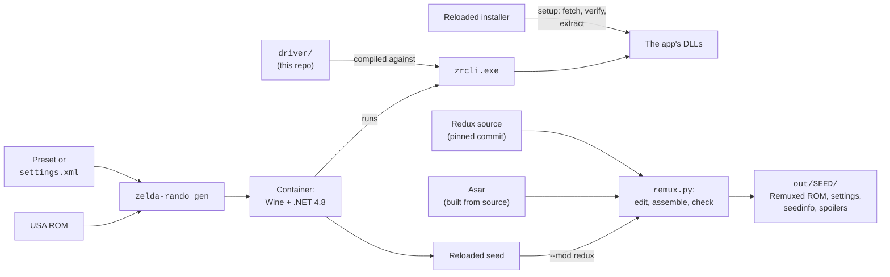

# Zelda Remuxed

A randomized Hyrule every game, with the quality of life of
[The Legend of Zelda Redux](https://github.com/ShadowOne333/The-Legend-of-Zelda-Redux), and any
seed reproducible from its seed string and settings file.

Two community projects, combined:

- **[Legend of Zelda Reloaded](https://www.reloadedretro.com/games/zelda)** (MetalMachine)
  builds a whole new overworld and new dungeons for every seed. It is a Windows program.
- **[The Legend of Zelda Redux](https://github.com/ShadowOne333/The-Legend-of-Zelda-Redux)**
  (ShadowOne333 and contributors) modernizes the original game: an automap, a better HUD,
  file copy and erase, bug fixes, new dungeon music and redrawn graphics.

Redux only patches the original ROM, and a Reloaded seed is a different ROM, so until now
you had to choose one. Zelda Remuxed runs Reloaded headless on Linux, then assembles
Redux's own source code onto each seed, one feature at a time.

New here? Start with [docs/getting-started.md](docs/getting-started.md) (about 30 minutes).
Something broken? See [docs/troubleshooting.md](docs/troubleshooting.md).

> [!IMPORTANT]
> This repo contains **none** of Reloaded, Redux or the ROM. Reloaded's license allows
> redistribution "in its original installable form only," so `zelda-rando setup` downloads
> the official installer and checks its SHA-256. Redux (GPL-3) and the Asar assembler are
> fetched from source at pinned commits by `zelda-rando setup-redux`. You supply your own
> unmodified *Legend of Zelda, The (USA)* ROM.

## Quick start

```sh
./bin/zelda-rando setup                          # once: Reloaded, the driver and the container (~10 min)
./bin/zelda-rando update-packages --community    # once: the graphics packs (hero sprites and more)
./bin/zelda-rando setup-redux                    # once: Redux and Asar, for --mod redux

export ZR_ROM="/path/to/Legend of Zelda, The (USA).nes"
./bin/zelda-rando gen --preset 01-new-hyrule --asset link=Zelda --asset "npc=The Quest of Zelda" \
    --mod redux --out out
```

The result is `out/<SEED>/`: the ROM, its `settings.xml`, `seedinfo.txt` and spoiler maps.

## How it fits together



| Piece | What it is |
|---|---|
| `bin/zelda-rando` | The command you run. Sets everything up and maps host paths into the container. |
| `driver/` | `zrcli`, a small C# program. It loads Reloaded's own DLLs and repeats what the Generate button does (`GenerateDlg.DoGeneration`). |
| `docker/Dockerfile` | Wine with Microsoft .NET Framework 4.8. |
| `presets/` | Five settings files, the script that builds them, and the hero sprite and NPC set each one uses. |
| `mods/redux/` | Zelda Remuxed: `remux.py`, the pinned commits (`PINS`) and the weekly `upstream-check`. Its [README](mods/redux/README.md) documents every edit, the RAM map and the safety checks. |
| `tools/automap.py` | Draws the automap picture and its region colours from a seed's own overworld. |
| `$ZR_HOME` | `~/.local/share/zelda-reloaded`: the extracted app, graphics packs, Redux, Asar and the installer cache. |

## What Remuxed adds to a seed

`--mod redux` applies all of these; `--mod redux:F1,F2,...` picks some.

| Feature | Redux file | What you get |
|---|---|---|
| `automap` | `gameplay/automap.asm` | Overworld map in the HUD, drawn from this seed's world and coloured by region (forest green, rock brown). Saved with your file. |
| `dungeon-automap` | `gameplay/dungeon_automap.asm` | Rooms appear on the dungeon map as you enter them |
| `hud-subscreen`, `arrows`, `rupees`, `hud-layout` | `menus/hud_and_subscreen.asm` and three more | Redux's HUD: life on the left, map on the right, quarter hearts, 999 rupees, an arrow counter |
| `copy-erase` | `menus/menu_tweaks.asm` | Copy and erase save files; a copy takes its map along |
| `item-toggle` | `gameplay/item_toggle.asm` | Select switches the B item instead of pausing |
| `save-hearts` | `menus/save_hearts.asm` | Keep the hearts you saved with (at least 3) |
| `sword-draw`, `sword-swing` | `gameplay/sword_*.asm` | The diagonal sword swing |
| `dungeon-music` | `music/dungeon_music.asm` | Four dungeon themes: the original, A New Light, Perils of Darkness and Triforce Power |
| `fix-*` (8) | `bugfixes/*.asm` | Redux's bug fixes |
| `graphics`, `graphics-overworld` | `gfx/graphics.asm` | Redux's art for the title, font, dungeons, bosses and overworld, wherever the graphics packs leave the original tiles |

Not ported: Redux's script and story rewrites, its overworld layout changes, visible
secrets and the Link sprite. Reloaded replaces the world, the text and the hero, so those
belong to the seed and its graphics packs.

## Commands

| Command | What it does |
|---|---|
| `zelda-rando setup` | Fetch and verify the Reloaded installer, build the driver and the container |
| `zelda-rando setup-redux` | Fetch Redux and Asar at the commits in `mods/redux/PINS`, verify Asar's SHA-256, build Asar |
| `zelda-rando update-packages [--community]` | Download graphics packs through the app's own updater |
| `zelda-rando list-assets [CATEGORY]` | List graphics packs: `link npc enemies bosses ganon items font overworld dungeons` |
| `zelda-rando defaults FILE` | Write the app's default settings, as a starting point |
| `zelda-rando gen [OPTIONS]` | Generate one seed |

| `gen` option | Meaning |
|---|---|
| `--preset NAME` | `presets/NAME.xml` |
| `--settings FILE` | A settings file: saved from the Windows app (*File → Save*), or the `settings.xml` beside an earlier seed |
| `--seed SEED` | Seed string. Omit for a random one. The same seed and settings give the same game. |
| `--asset CATEGORY=NAME` | A graphics pack by the name `list-assets` prints. Repeat for several categories. |
| `--mod redux[:F1,F2,...]` | Apply Redux features after generating |
| `--out DIR` | Output directory, default `./out`. Each seed gets its own folder. |
| `--name NAME` | ROM file name, without `.nes` |
| `--rom FILE` | The base ROM, or set `ZR_ROM` |
| `--timeout SECONDS` | Default 900. A chaos seed can take several minutes. |
| `-v` | Progress, the config hash and the sanity hash |

The ROM must be the unmodified **Legend of Zelda, The (USA)** (PRG0), 131,088 bytes,
SHA-1 of the PRG/CHR data `A12D74C73A0481599A5D832361D168F4737BBCF6`.

## The presets

| Preset | Title | Difficulty | Hero | Idea |
|---|---|---|---|---|
| `01-new-hyrule` | A New Hyrule | ★☆☆☆☆ | Zelda | Generated overworld and dungeons on First Quest rules, easier enemies, 4 hearts. A new map, not a new game. |
| `02-moonlit` | Hyrule by Moonlight | ★★☆☆☆ | Zelda (Breath of the Wild) | Night palette. Any rock wall may bomb open, any bush may burn. Second Quest dungeon shapes, new room designs. |
| `03-looking-glass` | Through the Looking Glass | ★★★☆☆ | Shadow Link | Mirrored, recolored world, upside-down dungeons entered from the north, swapped sprites, Bubbles that swap or invert the buttons. |
| `04-haunted` | The Haunting of Hyrule | ★★★★☆ | Zelda (The Quest of Zelda) | Invisible Ghini, half-faded enemies, blackout rooms, enemies hit 25% harder, Like Likes eat rings and rupees, Ganon warps. |
| `05-gauntlet` | Ganon's Gauntlet | ★★★★★ | Zelda (Hyrule Warriors) | Random enemy mixes, bosses as regular enemies, enemies hit 50% harder, two Bubble curses at once, a Ganon who heals and warps. |

Graphics packs are not part of a settings file. `presets/HEROES.tsv` lists each preset's
hero and, for the four with a Zelda hero, the NPC set *The Quest of Zelda*, which puts Link
in the princess's place in Level 9. Pass both with `--asset`. Graphics packs change only
sprite tiles, so a seed made with or without them has the same world and seed hash.

Edit a preset in `presets/make-presets.py`, then run `python3 presets/make-presets.py`.

## Reproducing a seed

The seed string plus `settings.xml` reproduce the game exactly. The sanity hash on the
title screen and in `seedinfo.txt` confirms two people have the same world.

```sh
zelda-rando gen --settings OLD/settings.xml --seed OLDSEED --out /tmp/check
cmp OLD/*.nes /tmp/check/OLDSEED/*.nes && echo identical
```

Without `--mod`, the ROM is byte-identical to the one the Windows app makes. This was
checked on 2026-10-14 against seed `9K8HMU15DR1Q`, made in the Windows app on 2025-02-10.
With `--mod redux`, the result also depends on the Redux commit in `mods/redux/PINS`.

## Design notes and gotchas

> [!CAUTION]
> **Reloaded's settings loader has a bug, and the driver works around it.**
> `OverworldConfig.Restore` reads `RecorderRulesPreset` into `UseBurnRulesPreset`, so loading a
> settings file overwrites the burn rules and never loads the recorder rules. The Windows app
> has the same bug when it reloads saved settings. The driver re-applies both values after
> loading (`LoadSettings` in `driver/Program.cs`). Without it, every seed differs from the app's.

- **Why real .NET and not wine-mono.** With .NET 4.8 the output matches the Windows app
  byte for byte, which is the acceptance test. wine-mono was not tested after the settings fix.
- **Why Wine at all.** Saving a ROM runs the bundled `snarfblasm.exe` assembler with
  hardcoded Windows paths.
- **Fonts.** The spoiler-map renderer asks for Courier New. winetricks' `courier` fails its
  checksum, so the image maps Courier New to Liberation Mono.
- **Avoid recorder rules "Anything goes" and "Second Quest".** `any` failed every overworld
  attempt in testing, and `q2` failed for presets 3 and 5. The presets use `default`.
- **Retries are normal.** The app retries up to 20 salts per seed and hides the failures;
  `-v` shows them. A seed only fails if all 20 do.
- **Determinism.** The RNG is seeded from the version string, a hash of the settings XML, the
  seed and the salt. Changing any setting changes every seed.
- **Remuxed is assembled, not patched.** `remux.py` edits Redux's source to move each feature
  out of Reloaded's way, then assembles it onto the seed. Every changed byte must be free
  space or a byte Reloaded left unchanged, features may not overwrite each other, and every
  source edit must match exactly once. Any failure stops the build. Details, and the measured
  battery-RAM map, are in [mods/redux/README.md](mods/redux/README.md).
- **Keeping up with Redux.** `mods/redux/upstream-check` builds against Redux's latest commit
  and reports whether the pin can move, or which edit needs adapting.

## Legal

The code in this repo is under the [MIT License](LICENSE): the wrapper, the driver, the
Dockerfile, the presets and the Remuxed tools, and nothing else.

*Legend of Zelda Reloaded* belongs to MetalMachine. Its license permits redistribution "in
its original installable form only" and free of charge, so setup downloads it from the
author. *The Legend of Zelda Redux* is GPL-3 (ShadowOne333 and contributors), including
Automap Plus by snarfblam and the dungeon automap by tacoschip; Remuxed fetches its source
and never redistributes it. Asar is built from its own source.

No ROMs are included. *The Legend of Zelda* is a trademark of Nintendo. This project is not
affiliated with or endorsed by Nintendo, MetalMachine or ShadowOne333.
